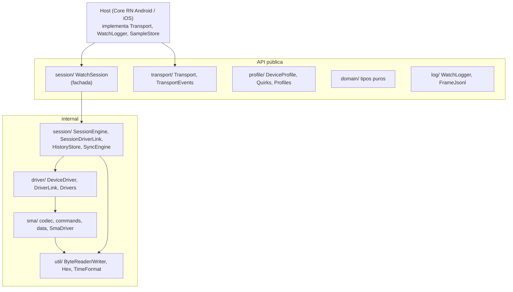
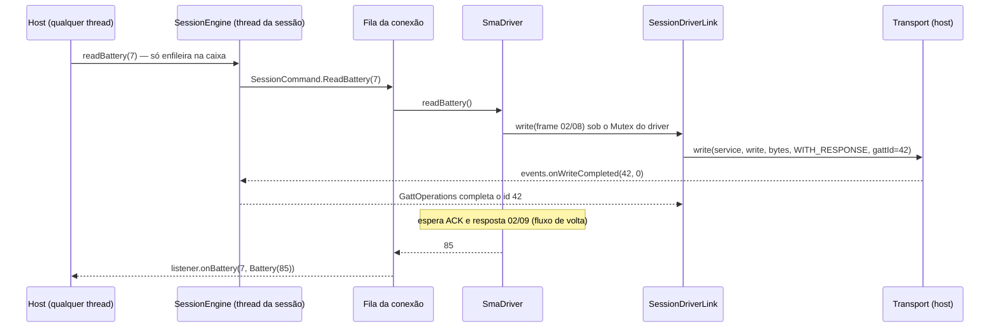
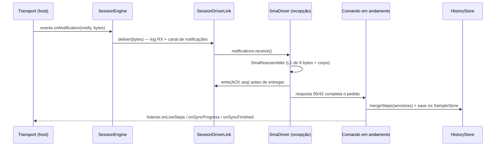
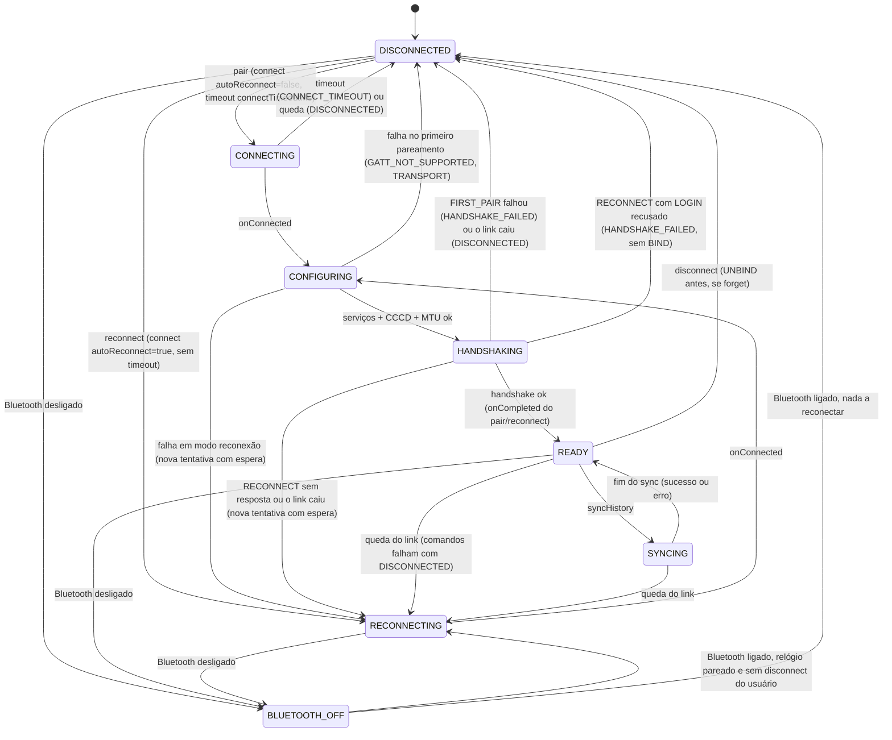

# Arquitetura do `technos-watch-protocol`

Este documento descreve como o módulo é dividido, quem pode depender de quem, por onde passam os bytes nos dois sentidos, em que thread tudo roda, a máquina de estados da sessão e o modelo de erros. O protocolo SMA em si está em [`protocolo-sma.md`](protocolo-sma.md) e [`sma-dados.md`](sma-dados.md); as decisões e riscos, em [`decisoes.md`](decisoes.md); o formato das gravações, em [`fixtures.md`](fixtures.md).

## 1. Camadas

| Pacote | Responsabilidade | Visibilidade |
|---|---|---|
| `domain/` | Tipos puros (`DeviceInfo`, `Battery`, `StepsSample`, `StepsDay`, `SleepSession`, `ConnectionState`, `DataKind`, `WatchErrorCodes`) e a `WatchException` interna | pública (menos a exceção) |
| `transport/` | `Transport` (o host implementa), `TransportEvents` (o host chama), tipos de descoberta GATT, `GattStatus`, `GattUuid` | pública |
| `profile/` | `DeviceProfile`, `Quirks`, `Profiles.MORMAII_FIT_GPS`, `DeviceRegistry` | pública |
| `log/` | `WatchLogger` (o host implementa), `FrameJsonl` (formato das gravações) | pública |
| `session/` | `WatchSession` e `WatchSessionListener` (públicos); `SessionEngine`, `SessionDriverLink`, `GattOperations`, `SessionCommand`, `SyncEngine`, `HistoryStore`, `StepsAggregator` (internos) | fachada pública |
| `driver/` | `DeviceDriver`, `DriverLink`, `DriverNotice`, `Drivers` (internos) e `HostDriver` (público, vazio) | interna |
| `sma/` | Protocolo SMA completo e `SmaDriver` | interna |
| `util/` | Bytes big-endian, hexadecimal, datas | interna |

**Regras de dependência**

- `session/` não importa nada de `sma/`: só `driver/Drivers.create(link)` conhece as famílias. Trocar ou acrescentar uma família não toca a sessão.
- `transport/` não conhece família nem protocolo: só bytes, UUIDs e status.
- `driver/` e `sma/` não conhecem `ConnectionState`, listener, fila nem store; recebem um `DriverLink` pronto.
- A API pública não usa `suspend`, `Flow`, `value class` nem tipos do `kotlinx-datetime` (Swift não os consome bem): datas são epoch millis e strings ISO. Por isso `TransportEvents`, `WatchSession` e o listener são de callback. A tarefa `./gradlew :protocol:checkObjcHeader` (parte do `check`) liga o framework do simulador e falha se o header `TechnosWatchProtocol.h` contiver `completionHandler`, `Kotlinx_coroutines`, `Kotlinx_datetime`, `Kotlinx_serialization`, `Flow` ou `Coroutine`.
- `domain/` e `profile/` não dependem de ninguém; `transport/` também não. A única dependência de `driver/` para uma família é `Drivers` importando o `SmaDriver`.
- Toda declaração pública tem KDoc: `./gradlew :protocol:dokkaHtml` roda com `reportUndocumented` e `failOnWarning`, então um símbolo público sem documentação quebra o build.

## 2. Fluxo app → relógio

Exemplo: `readBattery(7)` com a sessão em `READY`.

1. A chamada pública só coloca uma entrada na caixa da sessão (`Channel` ilimitado) e retorna.
2. A corrotina da caixa trata a entrada na thread da sessão: comandos vão para a fila da conexão atual, ou falham na hora com `NOT_READY`.
3. Um único consumidor por conexão executa um comando de cada vez (`DeviceDriver` não aceita chamadas paralelas).
4. O driver monta o frame (`SmaFrameCodec`), fragmenta (`SmaFragmenter`, `MTU - 3`) e escreve cada pedaço pelo `DriverLink`.
5. `SessionDriverLink.write` registra o pacote em `WatchLogger.frame` (TX), aloca um id GATT interno em `GattOperations`, chama `Transport.write` e suspende até o `onWriteCompleted` com o mesmo id. Status diferente de 0 vira `WatchException(TRANSPORT)`.

## 3. Fluxo relógio → app

- Notificações chegam pelo `TransportEvents`, passam pela caixa (a ordem é preservada) e vão para o canal do link da conexão atual, se a characteristic for a `notify` escolhida; caso contrário vão só para o log (DEBUG `Session/onNotification`, com o hex) e são descartadas. Elas não passam por `WatchLogger.frame`, então ficam fora da gravação: quem chama `frame` é só o link (`log/README.md`).
- O driver remonta, confere CRC, confirma com ACK **antes** de entregar (`docs/decisoes.md`, ADR 2) e casa a resposta com o pedido em andamento pelo `cmd` e `key + 1`.
- Avisos espontâneos (`02/70` DATA_CHANGED) viram `DriverNotice.DataChanged`; a sessão espera 2 s sem novos avisos e enfileira uma releitura interna de passos, que termina em `onLiveSteps(NO_REQUEST_ID, hoje)`. O fitGPS 0.2.1 não mandou nenhum frame espontâneo (nem `02/70`, nem `04/62`) na gravação real, inclusive em dois períodos ociosos conectados de cerca de 384 s e 233 s (depois do `atMs` 123713 e entre os `atMs` 798532 e 1031806 de `fixtures/real/fitgps/0.2.1/pair-commands-bt-reconnect-sync.jsonl`): sem o `02/6F`, passos novos só chegam por "Refresh steps" ou sync (`protocolo-sma.md`, seção 6).
- O driver registra uma linha `SmaDriver/frame` (DEBUG) por frame de dados completo em cada sentido, com seq, `cmd/key`, nome, tamanho do value e, no RX, `crc=ok`; os pacotes crus saem só por `WatchLogger.frame`, uma vez (seção 2, passo 5).
- O que é lido do relógio vai para o `HistoryStore` (instantâneo em memória + `SampleStore` do host). `getStepsDays`/`getSleepSessions` respondem só a partir dele, nunca do relógio (ADR 8).

## 4. Threading

- **Uma thread lógica.** `WatchSession` cria `CoroutineScope(SupervisorJob() + context)`, com `context = Dispatchers.Default.limitedParallelism(1)` em produção. Os testes usam o construtor interno com `StandardTestDispatcher(testScheduler)` e tempo virtual. Todo estado mutável da máquina de estados é tocado só ali, sem travas.
- **Caixa única.** Chamadas do host e eventos do `TransportEvents` entram no mesmo `Channel(UNLIMITED)` via `trySend` (nunca bloqueia nem suspende quem chama) e são tratados em ordem por uma corrotina. O tratador nunca suspende por muito tempo: configuração GATT, handshake, comandos, sync, timeouts e o debounce rodam em corrotinas filhas.
- **Escopo por conexão.** Cada tentativa de conexão (`Attempt`) tem um escopo filho com `SupervisorJob`; quando o link cai, a sessão falha os comandos, fecha driver e link, acorda as esperas GATT com `DISCONNECTED` e cancela esse escopo. Nada da conexão antiga sobrevive para tocar a nova.
- **Leituras de qualquer thread.** `state`, `currentAddress` e `currentProfileId` são `@Volatile`. `getStepsDays`/`getSleepSessions` leem instantâneos imutáveis do `HistoryStore`, trocados por inteiro a cada gravação; `confirmUploaded` troca o conjunto de dias confirmados na hora (compare-and-set) e grava no store depois, na thread da sessão. Os instantâneos iniciais são carregados do `SampleStore` no construtor.
- **Callbacks.** `WatchSessionListener` e `WatchLogger` são chamados na thread da sessão (exceção: depois de `close`, um pedido novo recebe `onError(CANCELLED)` na thread de quem chamou). Exceção lançada pelo listener ou pelo logger é engolida e registrada; não derruba a sessão.
- **Exceções inesperadas** de qualquer corrotina da sessão vão para um `CoroutineExceptionHandler` que registra `Session/uncaught` em ERROR. Os testes de sessão conferem que esse log fica vazio.

## 5. Máquina de estados

O diagrama omite, para legibilidade, as setas de `disconnect` e de "Bluetooth desligado" saindo de todos os estados: as duas valem de qualquer estado. O código está em `session/SessionEngine.kt`.

**CONNECTING** (só no primeiro pareamento). `Transport.connect(address, autoReconnect = false)` e um timeout de `Quirks.connectTimeoutMs` (30 s no fitGPS). Sem `onConnected` a tempo: `Transport.disconnect`, `DISCONNECTED`, `onError(CONNECT_TIMEOUT)`.

**CONFIGURING.** Em ordem:
1. `discoverServices` (espera até 15 s). Status ≠ 0 ou silêncio → `TRANSPORT`.
2. Escolhe o primeiro `GattCandidate` do perfil cujo serviço **e** as duas characteristics (write e notify) apareceram, com UUIDs normalizados (`GattUuid.normalize`). No fitGPS: `FF60/FF61/FF62` antes do NUS (ADR 6); o firmware 0.2.1 só expõe o NUS. Nenhum → `GATT_NOT_SUPPORTED`.
3. `enableNotifications` na notify (espera `commandTimeoutMs`). Falha → `TRANSPORT`.
4. `requestMtu(quirks.requestMtu)` com espera de 2 s; falha ou silêncio → MTU 23 (ADR 5). Não é erro.
5. Cria o `SessionDriverLink` (o canal de notificações existe desde o passo 2, então nada notificado antes do driver se perde), `Drivers.create(link)`, `driver.start(escopo da conexão)` e começa a coletar `driver.notices`.

**HANDSHAKING.** `driver.handshake(FIRST_PAIR | RECONNECT)`. Cada fase (`"BIND"`, `"LOGIN"`) é anunciada como `onStateChanged(HANDSHAKING, fase)`. O BIND pode esperar `bindTimeoutMs` (60 s) pela confirmação na tela do relógio; durante esse tempo a sessão não reconecta (ADR 4).
- `FIRST_PAIR` falhou: `DISCONNECTED` + `onError(HANDSHAKE_FAILED)` (o código original, por exemplo `TIMEOUT`, vai na mensagem). Link caiu: `onError(DISCONNECTED)`. O primeiro pareamento nunca reconecta sozinho.
- `RECONNECT` recusado pelo relógio (LOGIN recusado com os dois formatos de payload; o driver nunca manda BIND numa reconexão): `DISCONNECTED` + `onError(HANDSHAKE_FAILED)` no `reconnect` pendente, se houver, e a sessão para de tentar sozinha (inclusive ao religar o Bluetooth). Só um `pair` refaz o vínculo (ADR 11).
- `RECONNECT` falhou de outro jeito (sem resposta, link caiu): continua em `RECONNECTING` e tenta de novo, com espera crescente.

**READY.** `onStateChanged(READY, null)`, `onCompleted` do `pair`/`reconnect` pendente, e o consumidor da fila começa. Depois de `postLoginDelayMs` (3 s) a sessão enfileira sozinha um `setTime` e um `enableDataChangeNotices` internos: erros deles só vão para o log.

**SYNCING.** Só durante um `syncHistory`; outros comandos continuam aceitos e esperam na fila. No fim (sucesso ou erro) volta para `READY` antes do terminal.

**RECONNECTING.** Entrada por queda do link depois de pronto, por falha de uma tentativa em modo reconexão, por `reconnect()` ou por Bluetooth religado. `Transport.connect(address, autoReconnect = true)` sem timeout: o host mantém a conexão pendente até o relógio voltar (no Android, `autoConnect = true`). Quedas de um link que já estava **pronto** (`READY`/`SYNCING`) reconectam na hora; tentativas que falharam (handshake sem resposta, configuração que falhou, conexão pendente que o host derrubou, link que caiu antes do `READY`) esperam 2 s, 4 s, 8 s… até 60 s, para não girar em falso. A espera volta a 2 s quando chega em `READY`.

**BLUETOOTH_OFF.** Bluetooth desligado: a tentativa é derrubada (comandos com `DISCONNECTED`; um `pair` em andamento falha com `DISCONNECTED`; um `reconnect` pendente continua pendente). A sessão não espera `onDisconnected` nenhum (contrato B, ADR 18): zera a contagem de desconexões esperadas, marca o transporte inativo e chama `Transport.disconnect` só para o host liberar recursos, sem contar. `pair` com Bluetooth desligado falha com `TRANSPORT`; `reconnect` também, mas a sessão guarda o alvo. Ao religar: se houver relógio pareado (chegou a `READY` ou veio de `reconnect`) e o usuário não pediu `disconnect`, vai para `RECONNECTING`; senão, `DISCONNECTED`. Uma conexão pendente que falhar depois de religar tem a espera crescente de sempre.

**pair/reconnect com outra conexão em andamento.** Não existe `BUSY`: a tentativa atual é derrubada (`Transport.disconnect`, comandos e pedido pendente com `CANCELLED`) e a nova começa. `reconnect` para o mesmo relógio já pronto termina na hora; para o mesmo relógio já reconectando, o pedido novo substitui o anterior.

**disconnect(forget).** Para de reconectar e cancela o pedido de ciclo de vida e os comandos (`CANCELLED`). Com `forget` e a sessão pronta, envia UNBIND pelo driver, esperando no máximo `commandTimeoutMs` (falha ou silêncio não impedem o resto). Depois `Transport.disconnect`, `DISCONNECTED`, e, com `forget`, `SampleStore.clear()`, instantâneos zerados e `currentAddress`/`currentProfileId` nulos. Termina com `onCompleted`.

**Desconexões esperadas.** Quando a sessão chama `Transport.disconnect` com link aberto ou conexão pendente, o host responde com um `onDisconnected` que pode chegar quando outra tentativa já começou (ex.: `pair` novo logo depois do anterior). A sessão conta essas respostas e ignora o mesmo número de `onDisconnected`; a contagem zera no próximo `onConnected`, porque o host é serial (ADR 12). O Bluetooth desligado é a exceção: ali nenhuma resposta vem, e a contagem zera (ADR 18). Um `onDisconnected` sem tentativa em andamento e fora da contagem é registrado em WARN (`link lost … with no connection attempt`): é o rastro de um host fora do contrato.

### Contrato que a sessão assume do host

- Toda operação com `requestId` termina com exatamente um evento com o mesmo id (já está no KDoc de `Transport`).
- `Transport.disconnect` termina com **um** `onDisconnected` quando havia link aberto ou conexão pendente, e com nenhum quando não havia. Um host que nunca responde ao cancelar uma conexão pendente faz a sessão ignorar a próxima queda verdadeira antes do próximo `onConnected` (ver `docs/decisoes.md`, ADR 12).
- O host entrega os eventos na ordem em que aconteceram (um `onDisconnected` antigo antes do `onConnected` novo).
- Um `connect` que falha sem chegar a conectar termina com **um** `onDisconnected`: a conexão direta que falha e o `connect` que o host recusa na hora (Bluetooth desligado, sem permissão, endereço inválido). Só a conexão pendente (`autoReconnect = true`) que falha antes de conectar pode ficar sem evento, porque o host a mantém até o relógio voltar ou até um `disconnect`. Sem esse evento, um `reconnect` (sem timeout) ficaria preso em `RECONNECTING`; num `pair`, só o timeout de conexão encerraria a tentativa, e o `disconnect` dele contaria uma resposta que não vem (ADR 12).
- **Bluetooth desligado, contrato B** (ADR 18): o host entrega `onBluetoothStateChanged(false)` e nenhum `onDisconnected` pelos links abertos e conexões pendentes que isso derrubou, nem antes nem depois. Depois disso, `disconnect()` não emite nada até um novo `connect()`. Um `onDisconnected` que o host já tinha entregado antes do `onBluetoothStateChanged(false)` (o stack reportou a queda antes do aviso) é uma queda comum: a sessão passa por um `RECONNECTING` breve, com um `connect` para o adaptador que está desligando, e vai para `BLUETOOTH_OFF` quando o aviso chega. Na gravação real, o host Android antigo entregou três `onDisconnected` para um link só, todos fora do contrato B: o primeiro saiu do próprio tratamento do desligamento, logo antes de repassar o aviso (log, ts 1793272958346 e 1793272958357), e a sessão o tratou como essa queda comum; os outros dois chegaram depois do aviso. O host Android agora suprime os três, e a sessão vai direto para `BLUETOOTH_OFF`.

## 6. Fila de comandos

- Aceita só em `READY`/`SYNCING` e se a conexão não estiver sendo encerrada; fora disso, `onError(NOT_READY)` na hora.
- FIFO, um comando por vez, no escopo da conexão. Comandos internos (acerto de hora pós-login, `enableDataChangeNotices`, releitura depois de `02/70`) usam a mesma fila.
- `readDeviceInfo` → `onDeviceInfo(DeviceInfo(profileId, address, bleName, firmware, bleVersion))`. O `bleName` é o primeiro nome do perfil: o `pair` recebe só o endereço, e o perfil só casa nomes exatos (`DeviceRegistry.identify`).
- `readBattery` → `onBattery`; `setTime` → `onCompleted` (hora e fuso do `WatchClock`); `refreshSteps` → lê passos, mescla e `onLiveSteps(id, hoje)`.
- `syncHistory(kinds)` → `SYNCING`, `onSyncStarted`, `onSyncProgress(0)`, passos (obrigatório), progresso, sono (exploratório: erro ou vazio só no log), `onSyncProgress(100)`, poda por `historyRetentionDays`, `READY`, `onSyncFinished`. Lista vazia = todos os tipos; a ordem é sempre passos → sono.

## 7. Histórico e consultas

- **Mescla.** Passos por `atEpochMillis` e sono por `startEpochMillis`: a leitura mais nova substitui a antiga. A chave é o instante já convertido com o fuso do telefone, não o relógio de parede cru do relógio (ADR 16). Cada mudança grava a lista inteira no `SampleStore`.
- **Janela da mescla de passos.** Antes de mesclar, a sessão descarta as amostras cujo dia (no fuso do telefone) é anterior a `hoje - historyRetentionDays`, a mesma fronteira da poda, e as do futuro: dia depois de hoje **e** mais de 3 h à frente de agora. Vale para `refreshSteps` e para `syncHistory`. Sem isso, um registro `mode 0` com data errada (relógio desacertado) viraria um dia pendente que nunca sai: a poda não apaga o futuro, e o `refreshSteps` não poda. A folga de 3 h guarda os passos reais de um relógio que ainda está no fuso antigo perto da meia-noite (telefone que foi para oeste, sync antes do acerto de hora da conexão); acima dela a amostra sai e, se o relógio apaga o que foi lido (H2), se perde (ADR 16, emenda). O log `Session/mergeSteps` diz quantas saíram (WARN quando alguma é do futuro) e quantas de amanhã entraram pela folga (INFO).
- **Agregação diária** (`StepsAggregator`), no fuso de `WatchClock.timeZoneId()` na hora da consulta, segundo `Quirks.stepsAggregation` do perfil atual (ou do fitGPS, sem perfil): `HOURLY_SUM` soma passos, calorias e distância; `DAY_CUMULATIVE` usa a amostra de mais passos do dia (ADR 1).
- **`getStepsDays(daysBefore)`**: todos os dias até hoje que têm amostra e não foram confirmados, em ordem crescente. `daysBefore` não corta os dias mais velhos, como nos dois Cores atuais (ADR 15): um dia não enviado de quem ficou mais tempo sem abrir o app volta mesmo quando o app pede 3 dias; o log registra quando isso acontece. **`onLiveSteps`** traz hoje mesmo sem amostra (zerado) e mesmo se hoje já foi confirmado.
- **`getSleepSessions(daysBefore)`**: sessões cujo `dayKey` (dia em que a pessoa acordou) vai até hoje, sem os dias confirmados de `SLEEP`; mesma regra de `daysBefore`.
- **Poda**: depois de cada sync, amostras, sessões e dias confirmados anteriores a `hoje - historyRetentionDays` (30 no fitGPS) saem do store.

## 8. Erros

Internamente tudo é `WatchException(code, message)`; nada atravessa a API pública: a sessão converte em `onError(requestId, code, message)`. Códigos (`WatchErrorCodes`):

| Código | Quem produz |
|---|---|
| `NOT_READY` | comando fora de `READY`/`SYNCING`; driver recusando comando antes do LOGIN |
| `UNSUPPORTED_DEVICE` | `pair`/`reconnect` com `profileId` desconhecido |
| `CONNECT_TIMEOUT` | primeiro pareamento sem `onConnected` em `connectTimeoutMs` |
| `GATT_NOT_SUPPORTED` | nenhum candidato GATT do perfil na descoberta |
| `HANDSHAKE_FAILED` | qualquer falha do handshake no primeiro pareamento (recusa, timeout, protocolo); numa reconexão, só o LOGIN recusado |
| `TIMEOUT` | comando sem ACK ou sem resposta (GET não tem retentativa) |
| `PROTOCOL` | frame inválido, resposta indecifrável, exceção inesperada do driver |
| `TRANSPORT` | status GATT de falha, host que não confirma uma operação, Bluetooth desligado em `pair`/`reconnect` |
| `DISCONNECTED` | link caiu com o pedido em andamento ou na fila |
| `CANCELLED` | `disconnect`, `close`, ou um `pair`/`reconnect` posterior substituiu o pedido |
| `NO_DATA`, `BUSY` | reservados; a sessão atual não emite (sono vazio é só log; não há `BUSY`, ver seção 5). O host pode usar `NO_DATA` por conta própria: o Core RN usa quando `getHistorySleep` não tem nenhuma noite gravada |

**Regra do callback terminal.** Cada pedido com `requestId` termina com **exatamente um** terminal (`onDeviceInfo`, `onBattery`, `onLiveSteps`, `onSyncFinished`, `onCompleted` ou `onError`). Como é garantido:
- `pair`/`reconnect`: o pedido fica num campo único da sessão e sai dele ao terminar (sucesso, erro ou substituição).
- Comandos: `SessionCommand.markFinished()` só devolve `true` uma vez; todo terminal passa por ele. Ao derrubar a conexão, a sessão falha todos os comandos aceitos e ainda não terminados (inclusive um que o canal já entregou ao consumidor, mas que ainda não começou), antes de cancelar o escopo.
- Recusas imediatas emitem e retornam. Depois de `close`, pedidos novos recebem `CANCELLED` na hora.
- Comandos internos usam `NO_REQUEST_ID` e nunca emitem `onError`; o host não deve usar `-1` como id.
- Teste: `TerminalCallbackInvariantTest` percorre sucesso, recusa, timeout, queda, Bluetooth, substituição, `disconnect(forget)` e `close` e confere um terminal por id.

## 9. Como um `VendorSdkDriver` entraria

Famílias que dependem da SDK do fabricante (ex.: iDO) não têm codec próprio: a SDK fala com o relógio. O ponto de costura é `driver/HostDriver` (pública e vazia nesta PoC):

1. Definir em `HostDriver` métodos de callback simples (sem `suspend`, que o Swift não implementa), espelhando `DeviceDriver`: `handshake(mode, callback)`, `readBattery(callback)`, `readSteps(callback)` etc., e um canal de avisos.
2. Criar um `VendorSdkDriver` interno que implementa `DeviceDriver` adaptando os callbacks com `suspendCancellableCoroutine` e ignora o `DriverLink` (a SDK é dona do BLE).
3. `Drivers.create` passa a receber o `HostDriver` registrado pelo host para a família, e o perfil ganha uma `Family` nova.
4. Para essas famílias, o `Transport` do host não abre GATT: a sessão precisaria de um modo em que `CONFIGURING` é pulado (o driver faz conexão e handshake). Essa é a única mudança na máquina de estados, e fica para quando o primeiro adaptador existir.

O resto (fila, sync, store, regra do terminal, listener) não muda.

## 10. Testes da sessão

- `commonTest/.../testing/`: `FakeTransport` (host síncrono e controlável), `SmaWatchSimulator` (relógio SMA em nível de byte, compartilhado com os testes do driver), `ReplayDriver` + `TxMasker` (replay de gravações), `ReplayScenario` (deduz as ações de uma gravação), `RecordingListener`, `SessionTestLogger`, `TestClock`.
- `commonTest/.../session/`: `WatchSessionLifecycleTest`, `WatchSessionCommandsTest`, `BluetoothOffContractTest` (contrato B), `TerminalCallbackInvariantTest`, `HistoryStoreTest`. Todos com `runTest` e tempo virtual; `runSession` fecha a sessão mesmo quando uma asserção falha (senão uma reconexão em ciclo não deixaria o teste terminar).
- `jvmTest/`: `RecordingLoader` (e `RecordingLoaderTest`), `SmaSessionReplayTest` (gravação sintética de ponta a ponta), `RealFixturesReplayTest` (toda gravação em `fixtures/real/`, uma linha `REPLAY` por arquivo no stdout), `Hci2JsonlTest`.
