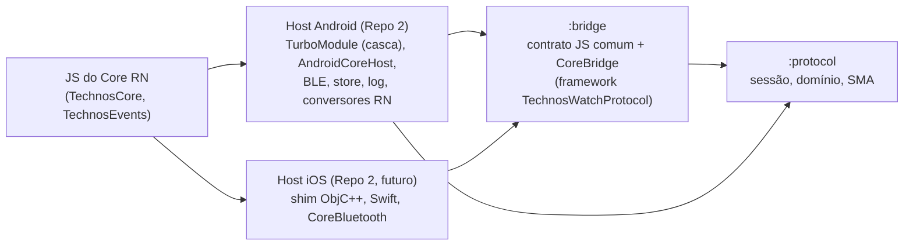
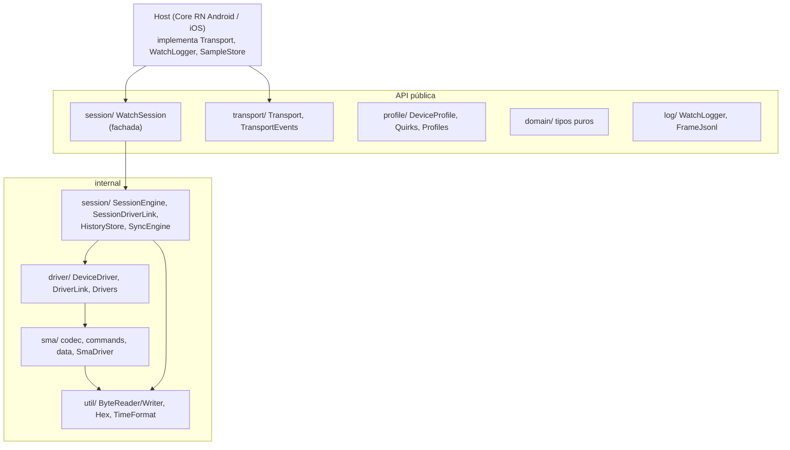
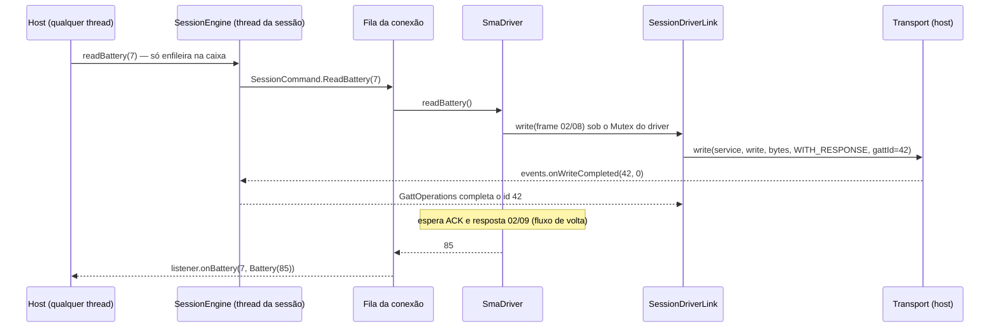
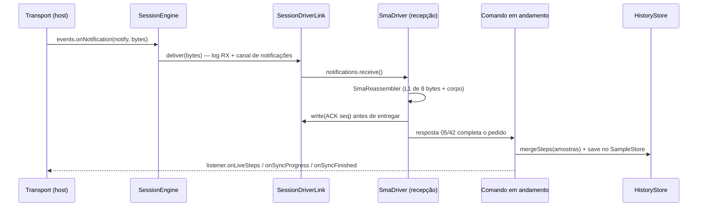
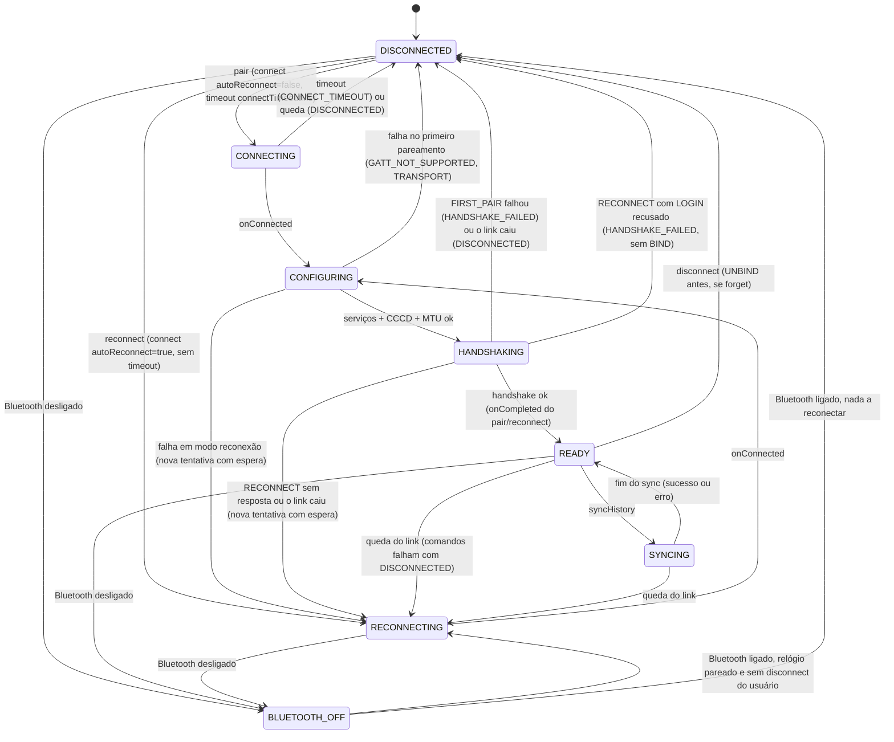
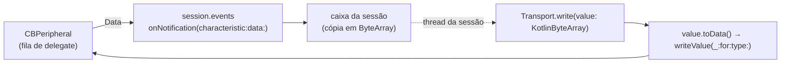
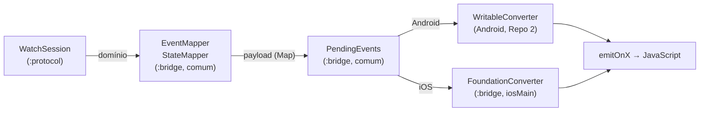
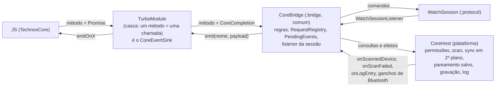

# Arquitetura do `technos-watch-protocol`

Este documento descreve como o repositório é dividido em módulos e pacotes, quem pode depender de quem, por onde passam os bytes nos dois sentidos, em que thread tudo roda, a máquina de estados da sessão, o modelo de erros, a ponte de bytes do host iOS (seção 11) o contrato JS comum do Core React Native, no módulo `:bridge` (seção 12), e o controlador comum que implementa cada método JS para os dois hosts (`CoreBridge`, seção 13). O protocolo SMA em si está em [`protocolo-sma.md`](protocolo-sma.md) e [`sma-dados.md`](sma-dados.md); as decisões e riscos, em [`decisoes.md`](decisoes.md); o formato das gravações, em [`fixtures.md`](fixtures.md).

## 1. Camadas

Dois módulos Gradle, com a dependência num sentido só:

| Módulo | Artefato | O que é | Depende de |
|---|---|---|---|
| `:protocol` | `br.com.grupotechnos.watch:protocol:0.1.0` | domínio, transporte, perfis, log, sessão e o protocolo SMA (o resto desta seção) | stdlib, `kotlinx-coroutines`, `kotlinx-datetime` |
| `:bridge` | `br.com.grupotechnos.watch:bridge:0.1.0` | o contrato JavaScript do Core React Native (`EventMapper`, `StateMapper`, `SavedDataMapper`, `HostErrorCodes`, `PendingEvents`, `RequestRegistry`, seção 12), o controlador que implementa cada método JS sobre a `WatchSession` (`CoreBridge`, com a plataforma atrás de `CoreHost`, `CoreEventSink` e `CoreCompletion`, seção 13) e o conversor para Foundation do iOS; gera o framework iOS `TechnosWatchProtocol` | `:protocol` (`api`), `kotlinx-datetime` |

O `:protocol` não conhece o `:bridge` (seria um ciclo, e o Gradle recusa). O host Android depende do artefato do `:bridge` pelo Maven local, que traz o do `:protocol` como `api` (o host usa os dois: o `CoreBridge` e, para montar a sessão, a `WatchSession` e o `Transport`); o host iOS consome um framework só, o guarda-chuva do `:bridge`, que exporta o `:protocol` inteiro.

Dentro do `:protocol`:

| Pacote | Responsabilidade | Visibilidade |
|---|---|---|
| `domain/` | Tipos puros (`DeviceInfo`, `Battery`, `StepsSample`, `StepsDay`, `SleepSession`, `ConnectionState`, `DataKind`, `WatchErrorCodes`) e a `WatchException` interna | pública (menos a exceção) |
| `transport/` | `Transport` (o host implementa), `TransportEvents` (o host chama), tipos de descoberta GATT, `GattStatus`, `GattUuid` | pública |
| `profile/` | `DeviceProfile`, `Quirks`, `Profiles.MORMAII_FIT_GPS`, `DeviceRegistry` | pública |
| `log/` | `WatchLogger` (o host implementa), `FrameJsonl` (formato das gravações) | pública |
| `session/` | `WatchSession` e `WatchSessionListener` (públicos); `SessionEngine`, `SessionDriverLink`, `GattOperations`, `SessionCommand`, `SyncEngine`, `HistoryStore`, `StepsAggregator` (internos) | fachada pública |
| `driver/` | `DeviceDriver`, `DriverLink`, `DriverNotice`, `Drivers` (internos) e `HostDriver` (público, vazio) | interna |
| `sma/` | Protocolo SMA completo e `SmaDriver` | interna |
| `util/` | Bytes big-endian, hexadecimal, datas | interna |
| `ios/` (só `iosMain`) | Ponte de bytes para o host Swift: `ByteArray` ↔ `NSData` e as sobrecargas de `TransportEvents` com `NSData` (seção 11) | pública, só no iOS |

**Regras de dependência**

- `session/` não importa nada de `sma/`: só `driver/Drivers.create(link)` conhece as famílias. Trocar ou acrescentar uma família não toca a sessão.
- `transport/` não conhece família nem protocolo: só bytes, UUIDs e status.
- `driver/` e `sma/` não conhecem `ConnectionState`, listener, fila nem store; recebem um `DriverLink` pronto.
- A API pública não usa `suspend`, `Flow`, `value class` nem tipos do `kotlinx-datetime` (Swift não os consome bem): datas são epoch millis e strings ISO. Por isso `TransportEvents`, `WatchSession` e o listener são de callback. A tarefa `./gradlew :bridge:checkObjcHeader` (parte do `check`) liga o framework guarda-chuva do simulador e falha se o header `TechnosWatchProtocol.h` contiver `completionHandler`, `Kotlinx_coroutines`, `Kotlinx_datetime`, `Kotlinx_serialization`, `Flow` ou `Coroutine`, ou se a `WatchSession`, o `Transport`, a ponte de bytes ou o contrato do `:bridge` não aparecerem exatamente uma vez. A regra vale para o `:bridge` também.
- `domain/` e `profile/` não dependem de ninguém; `transport/` também não. A única dependência de `driver/` para uma família é `Drivers` importando o `SmaDriver`.
- Toda declaração pública tem KDoc: `./gradlew dokkaHtml` roda nos dois módulos com `reportUndocumented` e `failOnWarning`, então um símbolo público sem documentação quebra o build. Vale também para o `iosMain` (o Dokka documenta o pacote `ios` de cada módulo no source set `iosMain`).
- O lado positivo do header: `./gradlew :bridge:checkSwiftInterop` (parte do `check`) compila com `swiftc -typecheck` um host Swift mínimo (`bridge/swift-interop/MinimalHost.swift`) contra o framework guarda-chuva; um nome, rótulo ou tipo que esse arquivo usa e que mude no header quebra o build (`decisoes.md`, ADRs 19 a 21). Ele usa toda a `WatchSession`, os protocolos que o host implementa (inclusive `CoreHost`, `CoreEventSink` e `CoreCompletion`), `TransportEvents` nas duas formas, a ponte de bytes, o domínio que o host mapeia e todo o `CoreBridge` (lista no `README.md` da pasta); o que ficar fora dele não é conferido. `./gradlew :bridge:checkObjcInterop` faz o mesmo para o shim Objective-C++ do TurboModule (`bridge/objc-interop/MinimalTurboModule.mm`, `clang++ -fsyntax-only` com ARC e `-Werror`): cada seletor do `TWPCoreBridge` que o shim chama e os protocolos que ele implementa.
- `ios/` só depende de `transport/` e da plataforma; nada do código comum depende dele.

## 2. Fluxo app → relógio

Exemplo: `readBattery(7)` com a sessão em `READY`.

1. A chamada pública só coloca uma entrada na caixa da sessão (`Channel` ilimitado) e retorna.
2. A corrotina da caixa trata a entrada na thread da sessão: comandos vão para a fila da conexão atual, ou falham na hora com `NOT_READY`.
3. Um único consumidor por conexão executa um comando de cada vez (`DeviceDriver` não aceita chamadas paralelas).
4. O driver monta o frame (`SmaFrameCodec`), fragmenta (`SmaFragmenter`, `MTU - 3`) e escreve cada pedaço pelo `DriverLink`.
5. `SessionDriverLink.write` registra o pacote em `WatchLogger.frame` (TX), aloca um id GATT interno em `GattOperations`, chama `Transport.write` e suspende até o `onWriteCompleted` com o mesmo id. Status diferente de 0 vira `WatchException(TRANSPORT)`.

## 3. Fluxo relógio → app

- Notificações chegam pelo `TransportEvents`, passam pela caixa (a ordem é preservada) e vão para o canal do link da conexão atual, se a characteristic for a `notify` escolhida; caso contrário vão só para o log (DEBUG `Session/onNotification`, com o hex) e são descartadas. Elas não passam por `WatchLogger.frame`, então ficam fora da gravação: quem chama `frame` é só o link (`log/README.md`).
- O driver remonta, confere CRC, confirma com ACK **antes** de entregar (`docs/decisoes.md`, ADR 2) e casa a resposta com o pedido em andamento pelo `cmd` e `key + 1`.
- Avisos espontâneos (`02/70` DATA_CHANGED) viram `DriverNotice.DataChanged`; a sessão espera 2 s sem novos avisos e enfileira uma releitura interna de passos, que termina em `onLiveSteps(NO_REQUEST_ID, hoje)`. O fitGPS 0.2.1 não mandou nenhum frame espontâneo (nem `02/70`, nem `04/62`) na gravação real, inclusive em dois períodos ociosos conectados de cerca de 384 s e 233 s (depois do `atMs` 123713 e entre os `atMs` 798532 e 1031806 de `fixtures/real/fitgps/0.2.1/pair-commands-bt-reconnect-sync.jsonl`): sem o `02/6F`, passos novos só chegam por "Refresh steps" ou sync (`protocolo-sma.md`, seção 6).
- O driver registra uma linha `SmaDriver/frame` (DEBUG) por frame de dados completo em cada sentido, com seq, `cmd/key`, nome, tamanho do value e, no RX, `crc=ok`; os pacotes crus saem só por `WatchLogger.frame`, uma vez (seção 2, passo 5).
- O que é lido do relógio vai para o `HistoryStore` (instantâneo em memória + `SampleStore` do host). `getStepsDays`/`getSleepSessions` respondem só a partir dele, nunca do relógio (ADR 8).

## 4. Threading

- **Uma thread lógica.** `WatchSession` cria `CoroutineScope(SupervisorJob() + context)`, com `context = Dispatchers.Default.limitedParallelism(1)` em produção. Os testes usam o construtor interno com `StandardTestDispatcher(testScheduler)` e tempo virtual, menos o `RealtimeReplayTest` e a sonda do `SessionThreadingTest` (abaixo). Todo estado mutável da máquina de estados é tocado só ali, sem travas. "Thread da sessão" quer dizer execução serial, não uma thread do sistema fixa: o `limitedParallelism(1)` garante um bloco por vez, em ordem, mas cada bloco pode rodar numa thread diferente do `Dispatchers.Default`. No iOS, o `Dispatchers.Default` do `kotlinx-coroutines` roda no pool do GCD, o mesmo que executa a fila de delegate do `CoreBluetooth`: a mesma thread do sistema pode servir à fila do host num momento e à sessão no seguinte, nunca as duas ao mesmo tempo.
- **Caixa única.** Chamadas do host e eventos do `TransportEvents` entram no mesmo `Channel(UNLIMITED)` via `trySend` (nunca bloqueia nem suspende quem chama) e são tratados em ordem por uma corrotina. O tratador nunca suspende por muito tempo: configuração GATT, handshake, comandos, sync, timeouts e o debounce rodam em corrotinas filhas.
- **Escopo por conexão.** Cada tentativa de conexão (`Attempt`) tem um escopo filho com `SupervisorJob`; quando o link cai, a sessão falha os comandos, fecha driver e link, acorda as esperas GATT com `DISCONNECTED` e cancela esse escopo. Nada da conexão antiga sobrevive para tocar a nova.
- **Leituras de qualquer thread.** `state`, `currentAddress` e `currentProfileId` são `@Volatile`. `getStepsDays`/`getSleepSessions` leem instantâneos imutáveis do `HistoryStore`, trocados por inteiro a cada gravação; `confirmUploaded` troca o conjunto de dias confirmados na hora (compare-and-set) e grava no store depois, na thread da sessão. Os instantâneos iniciais são carregados do `SampleStore` no construtor.
- **Callbacks do listener.** `WatchSessionListener` é chamado na thread da sessão, um callback por vez. Única exceção: depois de `close`, quando a thread da sessão já não existe, um pedido novo recebe `onError(CANCELLED)` na thread de quem chamou, e esse callback pode coincidir com os últimos do próprio `close`. Um evento que o host ainda entrega depois do `close` não gera callback. Exceção lançada pelo listener é engolida e registrada; não derruba a sessão. O host não deve depender da identidade da thread do callback (thread-local, thread guardada para comparar), só de que os callbacks são seriais e nunca rodam na fila de callbacks do Bluetooth dele.
- **Logger.** `WatchLogger` é chamado de mais de uma thread, às vezes ao mesmo tempo, e por isso tem de ser thread-safe (no Repo 2, o `RingLogger` do Android é sincronizado; o host iOS precisa da mesma garantia). `frame` e quase todo `log` saem na thread da sessão. Fora dela: `getStepsDays`, `getSleepSessions` e `confirmUploaded` chamam `log` na thread de quem chama, antes de retornar (dias anteriores à janela pedida, dia em formato inválido), e o construtor também, quando o `SampleStore` falha ao carregar (`SessionThreadingTest.synchronousCallsLogOnTheCallersThread`); depois de `close`, um evento que o host ainda entrega (a resposta ao `disconnect` do próprio `close`, uma notificação atrasada) é descartado com um DEBUG `Session/post` na thread do host (visto no `RealtimeReplayTest`). O logger não deve bloquear nem lançar. Se lançar, a exceção é engolida, como a do listener, nas linhas da `SessionEngine` e do `HistoryStore`: ela nunca escapa das consultas síncronas nem do construtor, e não interrompe mescla, poda nem gravação (`HistoryStoreTest.aThrowingLoggerNeverEscapes*`). O link (`frame`), o driver e o `SyncEngine` chamam o logger direto, na thread da sessão; ali ela faz a operação em andamento falhar: um `frame` que lança no RX perde a notificação, no TX falha o comando (`pendencias.md`, itens técnicos, 6).
- **Eventos do host.** `TransportEvents` pode ser chamado de qualquer thread (no Android, a thread de callbacks do `BluetoothGatt`; no iOS, a fila de delegate do `CBCentralManager`). Cada chamada só faz um `trySend` na caixa e retorna; nunca espera a sessão.
- **Conferido em tempo real.** O `RealtimeReplayTest` (`commonTest`, roda nos quatro targets) reproduz a gravação real com o construtor público, o dispatcher de produção e um host que entrega todos os eventos de uma fila serial própria (`dispatch_queue_create` no iOS, um executor de uma thread na JVM). Ele confere: os 167 TX e o histórico iguais aos do replay virtual; todo `TransportEvents` vindo da fila do host e retornando rápido (o mais lento medido ficou abaixo de 2 ms; o teste falha acima de 100 ms); nenhum callback do listener na fila do host (pela identidade da fila, `dispatch_get_specific` no iOS); e nenhum callback depois do `close`, nem com um evento atrasado do host. Os 59 callbacks da gravação rodaram em 1 a 3 threads do sistema, conforme a execução (`decisoes.md`, ADR 19). Ele também os vê em série, mas isso é observação desta carga, não prova do dispatcher: o replay é pergunta e resposta e uma corrotina só consome a caixa, então com `Dispatchers.Default` sem limite os callbacks também saem um por vez (mutação conferida na JVM e no iOS).
- **Dispatcher serial, conferido direto.** O `SessionThreadingTest` (`commonTest`, os quatro targets) lança blocos no contexto de uma sessão criada por cada construtor público (`WatchSession.sessionContext`, interno). Cada bloco espera outro, sem suspender, por até 50 ms: num dispatcher serial nunca há dois ao mesmo tempo. O controle com `Dispatchers.Default` sem limite vê dois ou mais, o que prova que a sonda enxerga paralelismo no target. Trocar o `limitedParallelism(1)` por `Dispatchers.Default` falha o teste na JVM e no iOS. A sonda não pega um dispatcher que não é paralelo mas roda na thread de quem retoma a corrotina (`Dispatchers.Unconfined`); esse cai no `RealtimeReplayTest`, com callbacks na fila do host. As duas checagens se completam.
- **Exceções inesperadas** de qualquer corrotina da sessão vão para um `CoroutineExceptionHandler` que registra `Session/uncaught` em ERROR. Os testes de sessão conferem que esse log fica vazio.

## 5. Máquina de estados

O diagrama omite, para legibilidade, as setas de `disconnect` e de "Bluetooth desligado" saindo de todos os estados: as duas valem de qualquer estado. O código está em `session/SessionEngine.kt`.

**CONNECTING** (só no primeiro pareamento). `Transport.connect(address, autoReconnect = false)` e um timeout de `Quirks.connectTimeoutMs` (30 s no fitGPS). Sem `onConnected` a tempo: `Transport.disconnect`, `DISCONNECTED`, `onError(CONNECT_TIMEOUT)`.

**CONFIGURING.** Em ordem:
1. `discoverServices` (espera até 15 s). Status ≠ 0 ou silêncio → `TRANSPORT`.
2. Escolhe o primeiro `GattCandidate` do perfil cujo serviço **e** as duas characteristics (write e notify) apareceram, com UUIDs normalizados (`GattUuid.normalize`). No fitGPS: `FF60/FF61/FF62` antes do NUS (ADR 6); o firmware 0.2.1 só expõe o NUS. Nenhum → `GATT_NOT_SUPPORTED`.
3. `enableNotifications` na notify (espera `commandTimeoutMs`). Falha → `TRANSPORT`.
4. `requestMtu(quirks.requestMtu)` com espera de 2 s; falha ou silêncio → MTU 23 (ADR 5). Não é erro.
5. Cria o `SessionDriverLink` (o canal de notificações existe desde o passo 2, então nada notificado antes do driver se perde), `Drivers.create(link)`, `driver.start(escopo da conexão)` e começa a coletar `driver.notices`.

**HANDSHAKING.** `driver.handshake(FIRST_PAIR | RECONNECT)`. Cada fase (`"BIND"`, `"LOGIN"`) é anunciada como `onStateChanged(HANDSHAKING, fase)`. O BIND pode esperar `bindTimeoutMs` (60 s) pela confirmação na tela do relógio; durante esse tempo a sessão não reconecta (ADR 4).
- `FIRST_PAIR` falhou: `DISCONNECTED` + `onError(HANDSHAKE_FAILED)` (o código original, por exemplo `TIMEOUT`, vai na mensagem). Link caiu: `onError(DISCONNECTED)`. O primeiro pareamento nunca reconecta sozinho.
- `RECONNECT` recusado pelo relógio (LOGIN recusado com os dois formatos de payload; o driver nunca manda BIND numa reconexão): `DISCONNECTED` + `onError(HANDSHAKE_FAILED)` no `reconnect` pendente, se houver, e a sessão para de tentar sozinha (inclusive ao religar o Bluetooth). Só um `pair` refaz o vínculo (ADR 11).
- `RECONNECT` falhou de outro jeito (sem resposta, link caiu): continua em `RECONNECTING` e tenta de novo, com espera crescente.

**READY.** `onStateChanged(READY, null)`, `onCompleted` do `pair`/`reconnect` pendente, e o consumidor da fila começa. Depois de `postLoginDelayMs` (3 s) a sessão enfileira sozinha um `setTime` e um `enableDataChangeNotices` internos: erros deles só vão para o log.

**SYNCING.** Só durante um `syncHistory`; outros comandos continuam aceitos e esperam na fila. No fim (sucesso ou erro) volta para `READY` antes do terminal.

**RECONNECTING.** Entrada por queda do link depois de pronto, por falha de uma tentativa em modo reconexão, por `reconnect()` ou por Bluetooth religado. `Transport.connect(address, autoReconnect = true)` sem timeout: o host mantém a conexão pendente até o relógio voltar (no Android, `autoConnect = true`). Quedas de um link que já estava **pronto** (`READY`/`SYNCING`) reconectam na hora; tentativas que falharam (handshake sem resposta, configuração que falhou, conexão pendente que o host derrubou, link que caiu antes do `READY`) esperam 2 s, 4 s, 8 s… até 60 s, para não girar em falso. A espera volta a 2 s quando chega em `READY`.

**BLUETOOTH_OFF.** Bluetooth desligado: a tentativa é derrubada (comandos com `DISCONNECTED`; um `pair` em andamento falha com `DISCONNECTED`; um `reconnect` pendente continua pendente). A sessão não espera `onDisconnected` nenhum (contrato B, ADR 18): zera a contagem de desconexões esperadas, marca o transporte inativo e chama `Transport.disconnect` só para o host liberar recursos, sem contar. `pair` com Bluetooth desligado falha com `TRANSPORT`; `reconnect` também, mas a sessão guarda o alvo. Ao religar: se houver relógio pareado (chegou a `READY` ou veio de `reconnect`) e o usuário não pediu `disconnect`, vai para `RECONNECTING`; senão, `DISCONNECTED`. Uma conexão pendente que falhar depois de religar tem a espera crescente de sempre.

**pair/reconnect com outra conexão em andamento.** Não existe `BUSY`: a tentativa atual é derrubada (`Transport.disconnect`, comandos e pedido pendente com `CANCELLED`) e a nova começa. `reconnect` para o mesmo relógio já pronto termina na hora; para o mesmo relógio já reconectando, o pedido novo substitui o anterior.

**disconnect(forget).** Para de reconectar e cancela o pedido de ciclo de vida e os comandos (`CANCELLED`). Com `forget` e a sessão pronta, envia UNBIND pelo driver, esperando no máximo `commandTimeoutMs` (falha ou silêncio não impedem o resto). Depois `Transport.disconnect`, `DISCONNECTED`, e, com `forget`, `SampleStore.clear()`, instantâneos zerados e `currentAddress`/`currentProfileId` nulos. Termina com `onCompleted`.

**Desconexões esperadas.** Quando a sessão chama `Transport.disconnect` com link aberto ou conexão pendente, o host responde com um `onDisconnected` que pode chegar quando outra tentativa já começou (ex.: `pair` novo logo depois do anterior). A sessão conta essas respostas e ignora o mesmo número de `onDisconnected`; a contagem zera no próximo `onConnected`, porque o host é serial (ADR 12). O Bluetooth desligado é a exceção: ali nenhuma resposta vem, e a contagem zera (ADR 18). Um `onDisconnected` sem tentativa em andamento e fora da contagem é registrado em WARN (`link lost … with no connection attempt`): é o rastro de um host fora do contrato.

### Contrato que a sessão assume do host

- Toda operação com `requestId` termina com exatamente um evento com o mesmo id (já está no KDoc de `Transport`).
- `Transport.disconnect` termina com **um** `onDisconnected` quando havia link aberto ou conexão pendente, e com nenhum quando não havia. Um host que nunca responde ao cancelar uma conexão pendente faz a sessão ignorar a próxima queda verdadeira antes do próximo `onConnected` (ver `docs/decisoes.md`, ADR 12).
- O host entrega os eventos na ordem em que aconteceram (um `onDisconnected` antigo antes do `onConnected` novo).
- Um `connect` que falha sem chegar a conectar termina com **um** `onDisconnected`: a conexão direta que falha e o `connect` que o host recusa na hora (Bluetooth desligado, sem permissão, endereço inválido). Só a conexão pendente (`autoReconnect = true`) que falha antes de conectar pode ficar sem evento, porque o host a mantém até o relógio voltar ou até um `disconnect`. Sem esse evento, um `reconnect` (sem timeout) ficaria preso em `RECONNECTING`; num `pair`, só o timeout de conexão encerraria a tentativa, e o `disconnect` dele contaria uma resposta que não vem (ADR 12).
- **Bluetooth desligado, contrato B** (ADR 18): o host entrega `onBluetoothStateChanged(false)` e nenhum `onDisconnected` pelos links abertos e conexões pendentes que isso derrubou, nem antes nem depois. Depois disso, `disconnect()` não emite nada até um novo `connect()`. Um `onDisconnected` que o host já tinha entregado antes do `onBluetoothStateChanged(false)` (o stack reportou a queda antes do aviso) é uma queda comum: a sessão passa por um `RECONNECTING` breve, com um `connect` para o adaptador que está desligando, e vai para `BLUETOOTH_OFF` quando o aviso chega. Na gravação real, o host Android antigo entregou três `onDisconnected` para um link só, todos fora do contrato B: o primeiro saiu do próprio tratamento do desligamento, logo antes de repassar o aviso (log, ts 1793272958346 e 1793272958357), e a sessão o tratou como essa queda comum; os outros dois chegaram depois do aviso. O host Android agora suprime os três, e a sessão vai direto para `BLUETOOTH_OFF`.

## 6. Fila de comandos

- Aceita só em `READY`/`SYNCING` e se a conexão não estiver sendo encerrada; fora disso, `onError(NOT_READY)` na hora.
- FIFO, um comando por vez, no escopo da conexão. Comandos internos (acerto de hora pós-login, `enableDataChangeNotices`, releitura depois de `02/70`) usam a mesma fila.
- `readDeviceInfo` → `onDeviceInfo(DeviceInfo(profileId, address, bleName, firmware, bleVersion))`. O `bleName` é o primeiro nome do perfil: o `pair` recebe só o endereço, e o perfil só casa nomes exatos (`DeviceRegistry.identify`).
- `readBattery` → `onBattery`; `setTime` → `onCompleted` (hora e fuso do `WatchClock`); `refreshSteps` → lê passos, mescla e `onLiveSteps(id, hoje)`.
- `syncHistory(kinds)` → `SYNCING`, `onSyncStarted`, `onSyncProgress(0)`, passos (obrigatório), progresso, sono (exploratório: erro ou vazio só no log), `onSyncProgress(100)`, poda por `historyRetentionDays`, `READY`, `onSyncFinished`. Lista vazia = todos os tipos; a ordem é sempre passos → sono.

## 7. Histórico e consultas

- **Mescla.** Passos por `atEpochMillis` e sono por `startEpochMillis`: a leitura mais nova substitui a antiga. A chave é o instante já convertido com o fuso do telefone, não o relógio de parede cru do relógio (ADR 16). Cada mudança grava a lista inteira no `SampleStore`.
- **Janela da mescla de passos.** Antes de mesclar, a sessão descarta as amostras cujo dia (no fuso do telefone) é anterior a `hoje - historyRetentionDays`, a mesma fronteira da poda, e as do futuro: dia depois de hoje **e** mais de 3 h à frente de agora. Vale para `refreshSteps` e para `syncHistory`. Sem isso, um registro `mode 0` com data errada (relógio desacertado) viraria um dia pendente que nunca sai: a poda não apaga o futuro, e o `refreshSteps` não poda. A folga de 3 h guarda os passos reais de um relógio que ainda está no fuso antigo perto da meia-noite (telefone que foi para oeste, sync antes do acerto de hora da conexão); acima dela a amostra sai e, se o relógio apaga o que foi lido (H2), se perde (ADR 16, emenda). O log `Session/mergeSteps` diz quantas saíram (WARN quando alguma é do futuro) e quantas de amanhã entraram pela folga (INFO).
- **Agregação diária** (`StepsAggregator`), no fuso de `WatchClock.timeZoneId()` na hora da consulta, segundo `Quirks.stepsAggregation` do perfil atual (ou do fitGPS, sem perfil): `HOURLY_SUM` soma passos, calorias e distância; `DAY_CUMULATIVE` usa a amostra de mais passos do dia (ADR 1).
- **`getStepsDays(daysBefore)`**: todos os dias até hoje que têm amostra e não foram confirmados, em ordem crescente. `daysBefore` não corta os dias mais velhos, como nos dois Cores atuais (ADR 15): um dia não enviado de quem ficou mais tempo sem abrir o app volta mesmo quando o app pede 3 dias; o log registra quando isso acontece. **`onLiveSteps`** traz hoje mesmo sem amostra (zerado) e mesmo se hoje já foi confirmado.
- **`getSleepSessions(daysBefore)`**: sessões cujo `dayKey` (dia em que a pessoa acordou) vai até hoje, sem os dias confirmados de `SLEEP`; mesma regra de `daysBefore`.
- **Poda**: depois de cada sync, amostras, sessões e dias confirmados anteriores a `hoje - historyRetentionDays` (30 no fitGPS) saem do store.

## 8. Erros

Internamente tudo é `WatchException(code, message)`; nada atravessa a API pública: a sessão converte em `onError(requestId, code, message)`. Códigos (`WatchErrorCodes`):

| Código | Quem produz |
|---|---|
| `NOT_READY` | comando fora de `READY`/`SYNCING`; driver recusando comando antes do LOGIN |
| `UNSUPPORTED_DEVICE` | `pair`/`reconnect` com `profileId` desconhecido |
| `CONNECT_TIMEOUT` | primeiro pareamento sem `onConnected` em `connectTimeoutMs` |
| `GATT_NOT_SUPPORTED` | nenhum candidato GATT do perfil na descoberta |
| `HANDSHAKE_FAILED` | qualquer falha do handshake no primeiro pareamento (recusa, timeout, protocolo); numa reconexão, só o LOGIN recusado |
| `TIMEOUT` | comando sem ACK ou sem resposta (GET não tem retentativa) |
| `PROTOCOL` | frame inválido, resposta indecifrável, exceção inesperada do driver |
| `TRANSPORT` | status GATT de falha, host que não confirma uma operação, Bluetooth desligado em `pair`/`reconnect` |
| `DISCONNECTED` | link caiu com o pedido em andamento ou na fila |
| `CANCELLED` | `disconnect`, `close`, ou um `pair`/`reconnect` posterior substituiu o pedido |
| `NO_DATA`, `BUSY` | reservados; a sessão atual não emite (sono vazio é só log; não há `BUSY`, ver seção 5). O host pode usar `NO_DATA` por conta própria: o Core RN usa quando `getHistorySleep` não tem nenhuma noite gravada |

**Regra do callback terminal.** Cada pedido com `requestId` termina com **exatamente um** terminal (`onDeviceInfo`, `onBattery`, `onLiveSteps`, `onSyncFinished`, `onCompleted` ou `onError`). Como é garantido:
- `pair`/`reconnect`: o pedido fica num campo único da sessão e sai dele ao terminar (sucesso, erro ou substituição).
- Comandos: `SessionCommand.markFinished()` só devolve `true` uma vez; todo terminal passa por ele. Ao derrubar a conexão, a sessão falha todos os comandos aceitos e ainda não terminados (inclusive um que o canal já entregou ao consumidor, mas que ainda não começou), antes de cancelar o escopo.
- Recusas imediatas emitem e retornam. Depois de `close`, pedidos novos recebem `CANCELLED` na hora.
- Comandos internos usam `NO_REQUEST_ID` e nunca emitem `onError`; o host não deve usar `-1` como id.
- Teste: `TerminalCallbackInvariantTest` percorre sucesso, recusa, timeout, queda, Bluetooth, substituição, `disconnect(forget)` e `close` e confere um terminal por id.

## 9. Como um `VendorSdkDriver` entraria

Famílias que dependem da SDK do fabricante (ex.: iDO) não têm codec próprio: a SDK fala com o relógio. O ponto de costura é `driver/HostDriver` (pública e vazia nesta PoC):

1. Definir em `HostDriver` métodos de callback simples (sem `suspend`, que o Swift não implementa), espelhando `DeviceDriver`: `handshake(mode, callback)`, `readBattery(callback)`, `readSteps(callback)` etc., e um canal de avisos.
2. Criar um `VendorSdkDriver` interno que implementa `DeviceDriver` adaptando os callbacks com `suspendCancellableCoroutine` e ignora o `DriverLink` (a SDK é dona do BLE).
3. `Drivers.create` passa a receber o `HostDriver` registrado pelo host para a família, e o perfil ganha uma `Family` nova.
4. Para essas famílias, o `Transport` do host não abre GATT: a sessão precisaria de um modo em que `CONFIGURING` é pulado (o driver faz conexão e handshake). Essa é a única mudança na máquina de estados, e fica para quando o primeiro adaptador existir.

O resto (fila, sync, store, regra do terminal, listener) não muda.

## 10. Testes da sessão

- O kit de teste, em `protocol/src/testKit/` (pastas que o `:protocol` e o `:bridge` compilam nos próprios testes; `protocol/src/testKit/README.md`): `FakeTransport` (host síncrono e controlável), `SmaWatchSimulator` (relógio SMA em nível de byte, compartilhado com os testes do driver), `ReplayDriver` + `TxMasker` (replay de gravações), `ReplayScenario` (deduz as ações de uma gravação), `RecordingListener`, `SessionTestLogger`, `TestClock`, a `SessionHarness` (`runSession`) e a leitura das gravações nos quatro targets (`RecordingLoader`, o `expect` de arquivo `FixtureFiles`, com os `actual` em `testKitJvm/` e `testKitIos/`). O `:bridge` usa o mesmo kit para testar o `CoreBridge` sobre uma sessão de verdade (seção 13).
- `commonTest/.../session/`: `WatchSessionLifecycleTest`, `WatchSessionCommandsTest`, `BluetoothOffContractTest` (contrato B), `TerminalCallbackInvariantTest`, `HistoryStoreTest`. Todos com `runTest` e tempo virtual; `runSession` fecha a sessão mesmo quando uma asserção falha (senão uma reconexão em ciclo não deixaria o teste terminar).
- `commonTest/.../testing/` tem o que é só do `:protocol`: `SyntheticFitGpsFixture` e o replay em tempo real, `RealtimeReplay` e a `HostQueue` (fila serial do host, `expect`/`actual`; os `actual` em `src/jvmSharedTest/`, compilado por `jvmTest` e `androidUnitTest`, e em `iosTest/`).
- `commonTest/.../session/RealFixturesReplayTest` (toda gravação em `fixtures/real/` e a sintética, uma linha `REPLAY` por arquivo no stdout de cada target) e `RealtimeReplayTest` (a gravação real no dispatcher de produção, em tempo real, seção 4; linha `REALTIME-REPLAY`); `SessionThreadingTest` (o dispatcher dos construtores públicos é serial; o logger nas consultas síncronas, seção 4).
- `jvmTest/`: só o que precisa da JVM: `RecordingLoaderTest` (o `java.time` como oráculo do `recordedAt`), `SmaSessionReplayTest` (gravação sintética de ponta a ponta e a regravação com `FIXTURES_REGENERATE=1`), `Hci2JsonlTest` (roda o `python3`).
- `iosTest/.../ios/ByteBridgeTest`: a ponte de bytes do iOS (seção 11).

## 11. Ponte de bytes do iOS

No Swift, todo `ByteArray` da API pública aparece como `KotlinByteArray`, que só se lê byte a byte, e o `CoreBluetooth` só fala `Data`. O pacote `br.com.grupotechnos.watch.protocol.ios` (só no `iosMain`, compilado para `iosArm64` e `iosSimulatorArm64`) fecha essa distância sem mudar a API comum:

| Sentido | Onde o host encontra os bytes | Swift |
|---|---|---|
| sessão → host | `Transport.write(service:characteristic:value:type:requestId:)`, `WatchLogger.frame(direction:characteristic:value:summary:)` (`value: KotlinByteArray`) | `let data: Data = value.toData()` |
| host → sessão | `peripheral(_:didUpdateValueFor:error:)` de uma notificação (`characteristic.value: Data?`) | `session.events.onNotification(characteristic: uuid, data: value)` |
| host → sessão | o mesmo callback, de uma leitura pedida por `Transport.read` | `session.events.onReadCompleted(requestId: id, data: value, status: status)` |
| `Data` → `KotlinByteArray` | o resto da API que recebe bytes (`FrameJsonl.line`) | `ByteBridgeKt.toByteArray(data)` |

- Toda conversão copia (`initWithBytes:length:` num sentido, `getBytes:length:` no outro): o host pode reutilizar o buffer, e mudar a origem depois não muda o resultado. Tamanho 0 não toca em endereço (um `NSData` vazio pode ter `bytes` nulo; um `ByteArray` vazio não tem elemento 0 para fixar).
- As sobrecargas com `NSData` chamam o método comum: mesmo evento, mesma ordem, mesmo "retorna na hora, de qualquer thread". O rótulo é `data:`, e não `value:`, para não colidir no Objective-C com os métodos que recebem `KotlinByteArray`; o nome `toData()` vem de `@ObjCName`.
- O `value` de `WatchLogger.frame` vai direto para `FrameJsonl.shared.line(...)`, sem conversão.
- Tabela completa, invariantes e testes: `protocol/src/iosMain/.../ios/README.md`. A decisão: `decisoes.md`, ADR 19. O MTU que o host iOS informa (`maximumWriteValueLength(for: .withoutResponse) + 3`): KDoc de `Transport.requestMtu` e ADR 5, emenda.

## 12. Contrato JS comum (`:bridge`)

O Core React Native (`react-native-technos-core-next`) promete ao JavaScript os nomes e formatos do Core atual (`src/types/events.ts`, `src/specs/NativeCoreNext.ts` de lá). A parte desse contrato que não depende de plataforma mora no `:bridge`, em código comum, para os hosts Android e iOS entregarem exatamente o mesmo:

| Tipo | O que garante |
|---|---|
| `EventMapper` | O payload de cada evento e retorno (`onScannedDevice`, `onConnectStateChanged`, `onDeviceInfo`, `onFirmwareInfo`, `onBatteryStatus`, `onPedometer`, `onHistoryPedometer`, `onHistorySleep`, `onSyncProgress`, `onError`, `onLog`, `getLastPairedDevice`) como `Map<String, Any?>`; o `date` do sono pelo início do dia no fuso do telefone. |
| `StateMapper` | `ConnectionState` → `deviceConnectStates` (0, 1, 2, 4) e o `isConnected`. |
| `SavedDataMapper` | `deletedSavedData`: a categoria do Core atual → `DataKind`, e cada `registered_at` → dia local, com as mesmas leituras (e recusas) do `java.time` do host Android antigo. |
| `HostErrorCodes` | Os códigos que o host produz antes de chamar a sessão. |
| `PendingEvents` | A fila de eventos enquanto o módulo JS não pode emitir (antes de o JS criar o TurboModule, entre um reload e outro): entrega em ordem, dentro de uma trava reentrante, capacidade 500. |
| `RequestRegistry` | `requestId` → quem liquida a Promise e o nome do método JS (o `method` do `onError`), um terminal só; ids de 1 a `Int.MAX_VALUE`, nunca `-1`. |
| `ios/FoundationConverter` (só iOS) | Os payloads como `NSDictionary`/`NSArray` com `CFBoolean` de verdade (seção 11 tem a ponte de bytes; esta é a dos payloads). |

- **Tipos dos valores**: `Int` para inteiros, `Double` para decimais e epoch millis, `String`, `Boolean`, `null`, mapas e listas aninhados. É o que o `WritableConverter` do Android sempre recebeu; o `FoundationConverter` aplica as mesmas regras no iOS e põe os booleanos como `CFBoolean`, porque o React Native separa `true`/`false` de número pela classe (`__NSCFBoolean`), e o `KotlinBoolean` que o Kotlin/Native gera viraria `1`/`0`.
- **Datas**: `IsoDates` (interno) lê e escreve o texto à mão, reproduzindo o `java.time`; o `kotlinx-datetime` faz só o fuso. Prova: `IsoDatesDifferentialTest` (ADR 20).
- **Fuso**: o do telefone na hora da chamada (`TimeZone.currentSystemDefault()`); as sobrecargas com fuso são internas, porque um tipo do `kotlinx-datetime` não pode ir para o header ObjC.
- **Exceções no iOS**: exceção Kotlin que cruza para o Swift sem `@Throws` encerra o processo. `EventMapper.startOfDayIso`, `sleepDay` e `historySleep`, que lançam `IllegalArgumentException` com um `dayKey` inválido, têm `@Throws`: no Swift são `throws`, e o erro chega como `NSError` (ADR 20).
- **Threads**: `EventMapper`, `StateMapper` e `SavedDataMapper` não têm estado. `PendingEvents` e `RequestRegistry` são chamados de qualquer thread (a da sessão, a do módulo nativo, a principal) e usam uma trava reentrante de plataforma (`ReentrantLock` na JVM, `NSRecursiveLock` no iOS).
- **Framework iOS**: o `:bridge` gera o `TechnosWatchProtocol` com o `:protocol` exportado (`export(project(":protocol"))`): um framework só, prefixo `TWP`, os nomes de sempre no Swift (`WatchSession`, `EventMapper`, `FoundationConverter`), e os tipos do `:protocol` uma vez só. `./gradlew assembleTechnosWatchProtocolXCFramework` → `bridge/build/XCFrameworks/{debug,release}/TechnosWatchProtocol.xcframework`.
- **O controlador** que implementa cada método JS (checagens do host, registro do pedido, regra do `NO_DATA`, pareamento salvo, ciclo de vida) e o lado `WatchSessionListener` também é comum: `CoreBridge`, seção 13. Tabela, invariantes e testes de cada tipo: `bridge/src/commonMain/.../bridge/README.md` e `bridge/src/iosMain/.../bridge/ios/README.md`.

## 13. Controlador comum (`CoreBridge`)

O `CoreBridge` implementa, em código comum, cada método JS de `src/specs/NativeCoreNext.ts` (Repo 2) e o lado `WatchSessionListener` da sessão. Ele veio do host Android antigo (`NativeCoreNextModule`, `CoreSessionListener` e as regras do `CoreGraph`) sem mudar nada que o JavaScript observa: os mesmos eventos e payloads, a mesma ordem (o evento sai antes do `resolve`), as mesmas rejeições, o mesmo `NO_DATA`, as mesmas regras do pareamento salvo e da reconexão automática, o mesmo ciclo de vida. O TurboModule de cada plataforma vira uma casca: cada método chama o de mesmo nome do `CoreBridge` com uma `CoreCompletion` que embrulha a Promise. Decisão e custos: `decisoes.md`, ADR 21.

**Montagem, uma vez por processo.** O host cria a `WatchSession` com o próprio `Transport`, `WatchLogger` e `SampleStore`, liga o transporte aos `TransportEvents` e passa a sessão, o logger e o `CoreHost` ao construtor `CoreBridge(session, logger, host)`, que chama `session.setListener`. A sessão vem pronta, e não é montada dentro do controlador, porque o host já a precisa para ligar o transporte, porque o construtor da `WatchSession` é o contrato do `:protocol` que o Swift já usa, e porque os testes do controlador montam uma `WatchSession` de verdade em tempo virtual (com o dispatcher de teste, o que só um teste consegue).

**Quem faz o quê.**

| `CoreBridge` (comum) | Host (cada plataforma) |
|---|---|
| Ordem das checagens e as rejeições antecipadas (`PERMISSION_DENIED`, `BLUETOOTH_OFF`, `INVALID_ARGUMENT`, `UNSUPPORTED_DEVICE`), cada uma com `onError` (`requestId` `-1`) antes do `reject` | Responder às consultas: permissão de scan e de conexão, Bluetooth ligado, endereço válido (MAC no Android, UUID no iOS) |
| `resolveProfile(name)` (`appName`, nome BLE ou `id`), o `requestId` de cada comando (`RequestRegistry`) e a liquidação no callback terminal | Embrulhar a Promise numa `CoreCompletion` (no iOS, o valor passa pelo `FoundationConverter`) |
| A fila de eventos (`PendingEvents`) e quando entregá-la: no `attach`, a cada evento, no `onHostResume` | Ser o `CoreEventSink`: `canEmit` e o `emitOnX` de cada nome |
| Os efeitos do listener, na ordem do host antigo: pareamento salvo em todo `READY` (salvo depois de um disconnect/forget do usuário), trabalho em segundo plano ligado no `onSyncStarted` e desligado no fim, no erro do sync ou fora de `READY`/`SYNCING`, cabeçalho da gravação; depois o evento; depois a liquidação | Executar os efeitos: scan, FGS (Android) ou tarefa de segundo plano (iOS), guardar o pareamento, o cabeçalho da gravação de frames |
| A regra do `NO_DATA` do `getHistorySleep`, a janela do sono (retenção do perfil), o `deletedSavedData` (strings ou mapas, categoria, datas no fuso do telefone) | Converter os argumentos do JS para Kotlin (no Android, `ReadableConverter.toList`, pelo `getType` de cada item) |
| `userDisconnected`, `reconnectIfPaired` (pareamento salvo, ninguém desconectou, sessão em `DISCONNECTED`/`BLUETOOTH_OFF`, Bluetooth e permissão), `emitCurrentState` | Avisar os ganchos: módulo destruído (`invalidate`), app de volta ao primeiro plano (`onHostResume`), Bluetooth desligado/ligado, relógio achado no scan, falha do scan, entrada nova no log |
| `getLogs` (entradas → `EventMapper.log`), `setLogLevel` (0..3, inválido só loga) | O log em memória, o export para arquivo e o nível |
| — | `Transport` (BLE), `SampleStore`, `WatchLogger`, o Bluetooth já desligado na partida (no Android, `reportBluetoothOffAtStartup`) |

**`CoreHost` por plataforma.** A coluna do Android é o `AndroidCoreHost` do Repo 2 (montado pelo `CoreGraph`), que só delega para as mesmas peças que o host antigo usava; a do iOS é o plano do `CoreGraph.swift`. No Android o TurboModule já é a casca descrita acima: cada `override` é uma chamada ao `CoreBridge` com um `PromiseCompletion` (mapas e listas pelo `WritableConverter`), e a prova de equivalência com o host antigo está no `docs/arquitetura.md` do Repo 2.

| Método | Quando o `CoreBridge` chama | Android (`AndroidCoreHost`) | iOS (planejado) |
|---|---|---|---|
| `missingScanPermission()` | `scan` | `BlePermissions.hasScanPermission` / `scanPermissionName()` (`android.permission.BLUETOOTH_SCAN` na API 31+, `ACCESS_FINE_LOCATION` na 30-) | `CBManager.authorization` diferente de `.allowedAlways` → um nome para a mensagem (ex.: `"Bluetooth"`); `null` quando autorizado |
| `missingConnectPermission()` | `pairDevice`, `startPairingAttempt`, reconexão automática | `"BLUETOOTH_CONNECT"` sem `BlePermissions.hasConnectPermission` (API 31+); `null` na 30- | a mesma autorização do `CBManager` |
| `isBluetoothEnabled()` | `scan`, conexão, reconexão automática | `BlePermissions.isBluetoothEnabled` | `CBCentralManager.state == .poweredOn` |
| `isValidAddress(address)` | `pairDevice`, `startPairingAttempt` | `BluetoothAdapter.checkBluetoothAddress` | `UUID(uuidString:) != nil` |
| `startScan()` / `stopScan()` | `scan`; `pairDevice`, `stopScan`, Bluetooth desligado | `BleScanner.start/stop` | `scanForPeripherals` sem filtro de serviço / `stopScan` |
| `startSyncWork()` / `stopSyncWork()` | `onSyncStarted`; fim, erro ou queda do sync | `SyncForegroundService.start/stop` | `beginBackgroundTask` / `endBackgroundTask` |
| `loadPairing()` / `savePairing()` / `clearPairing()` | `getLastPairedDevice`, reconexão, janela do sono; `READY`; `forgetDevice` (duas vezes) | `PairingPrefs` (`SharedPreferences` `corenext.pairing`) | `UserDefaults` |
| `setRecordingDeviceName()` / `setRecordingFirmware()` | pareamento, reconexão, `onDeviceInfo` | `FrameRecorder.deviceName/firmware` | o gravador de frames do iOS |
| `logEntries(limit)` / `exportLogs()` / `clearLogs()` / `setLogLevel(level)` | `getLogs`, `exportLogs`, `clearLogs`, `setLogLevel` | `RingLogger.entries/writeTo/clear/minLevel`; o `exportLogs` grava frames e log em `getExternalFilesDir(null)/corenext/` | anel em memória + `os_log`; export para o diretório de documentos (`throws` no Swift) |

**Ganchos do processo.** `attach(sink)` na primeira chamada de um método JS de cada instância do módulo (no Android, o antigo `graph()`); `invalidate(sink)` quando a instância morre (rejeita com `CANCELLED`, `"Module invalidated"`, toda Promise pendente); `onHostResume()` ao voltar ao primeiro plano (entrega a fila e reconecta); `onBluetoothTurnedOff()` (para o scan) e `onBluetoothTurnedOn()` (reconecta, chamado depois de o transporte entregar `onBluetoothStateChanged(true)` à sessão); `onScannedDevice`/`onScanFailed` do scanner; `onLogEntry` do logger (o `onLog` não entra na fila). Os três primeiros só para um módulo que se ligou.

**Inventário resumido** (o completo, com as linhas do host antigo, está nos testes de contrato e no README do pacote):

| Método JS | Checagens | Evento(s) | Liquidação | Efeitos |
|---|---|---|---|---|
| `initialize`, `initSMASDK` | — | `onConnectStateChanged` do estado atual (fase `null`), relido até ficar estável | `resolve(null)` depois | reconexão automática (`"initialize"`) |
| `scan` | permissão de scan, Bluetooth | `onError` (`-1`, `method` `scan`) se falhar | sem Promise | `startScan` |
| `pairDevice` | permissão de conexão, Bluetooth, endereço, nome | os estados da sessão | `resolve(null)` no `READY`; `onError` + `reject` na falha | `stopScan`, `userDisconnected = false`, nome da gravação |
| `startPairingAttempt` | as mesmas | os estados; `onError` com o método na falha | `resolve(null)` **na hora** | sem `stopScan` |
| `disconnectCurrentDevice` | — | `DISCONNECTED` | `resolve(null)` | `userDisconnected = true` |
| `forgetDevice` | — | `DISCONNECTED` | `resolve(null)` | `userDisconnected = true`, `clearPairing` no pedido e de novo no fim, com `onCompleted` ou `onError` (se ninguém pareou no meio) |
| `isConnected`, `getLastPairedDevice` | — | — | `Boolean`; `{deviceId, name, profileId}` ou `null` | — |
| `getDeviceInfo` / `getFirmwareInfo` | — | só `onDeviceInfo` / só `onFirmwareInfo`; sem pedido registrado, os dois | `resolve(null)` depois | firmware e nome da gravação |
| `getBatteryStatus`, `refreshSteps` | — | `onBatteryStatus`, `onPedometer` | `resolve(null)` depois | — |
| `setTime` | — | — | `resolve(null)` | — |
| `syncDataHistory` | — | `onSyncStarted`, `onSyncProgress`…, `onSyncFinished` | `resolve(null)` depois | `startSyncWork` antes do `onSyncStarted`, `stopSyncWork` antes do `onSyncFinished` (ou do `onError`) |
| `getHistoryPedometer` | — | `onHistoryPedometer` (lista vazia também) | `resolve(null)` depois; `IO_ERROR` | — |
| `getHistorySleep` | — | `onHistorySleep`, ou `onError` `NO_DATA` (`"No sleep sessions stored"`) | `resolve(null)` depois; `reject(NO_DATA)`; `IO_ERROR` | — |
| `deletedSavedData` | — | — | sem Promise | `confirmUploaded` por tipo; WARN/INFO no log |
| `getLogs`, `exportLogs`, `clearLogs`, `setLogLevel` | — | `onError` `IO_ERROR` se o export lançar qualquer `Exception` (`IOException` no Android, `NSError` no iOS) | lista de entradas; caminho | o log do host |

Toda falha de comando que vem da sessão sai como `onError` com o nome do método JS (`method` `null` para a reconexão automática e para eventos espontâneos) e depois rejeita com o mesmo código e mensagem. As linhas de log do controlador têm a tag `CoreBridge/<método>` (no host antigo eram `CoreGraph/…`, `CoreSessionListener/…` e `NativeCoreNextModule/…`); as mensagens não mudaram.

**Threads.** Os métodos JS chegam da thread dos módulos nativos do React Native; os callbacks da sessão, da thread lógica dela; os ganchos, da principal ou da do Bluetooth; o `onLogEntry`, de qualquer uma. O estado compartilhado é o mesmo do host antigo: a fila e os pedidos em andamento são travados, e os dois sinalizadores (`userDisconnected`, o sync em andamento) são `@Volatile`. O `CoreEventSink.emit` roda dentro da trava reentrante da fila: não deve bloquear e pode voltar a chamar o controlador.

**Testes.** No `commonTest` do `:bridge`, nos quatro targets, sobre uma `WatchSession` de verdade com o kit de teste do `:protocol` (transporte falso, relógio SMA simulado, tempo virtual; `protocol/src/testKit/README.md`): um teste por linha do inventário, um `FakeCoreHost` e um `CoreEventSink` que gravam tudo num diário só (para conferir a ordem), e o `CoreBridgeGoldenTest`, que passa a gravação real do fitGPS pelo controlador, método JS por método JS, e compara o diário inteiro com `bridge/golden/` (com o replay estrito: `TX matched 167/167`). Do lado iOS, o `checkSwiftInterop` e o `checkObjcInterop` conferem que o Swift (um `CoreHost`, uma `CoreCompletion` e um `CoreEventSink` em Swift chamando todo o `CoreBridge`) e o shim Objective-C++ compilam contra o framework.
